

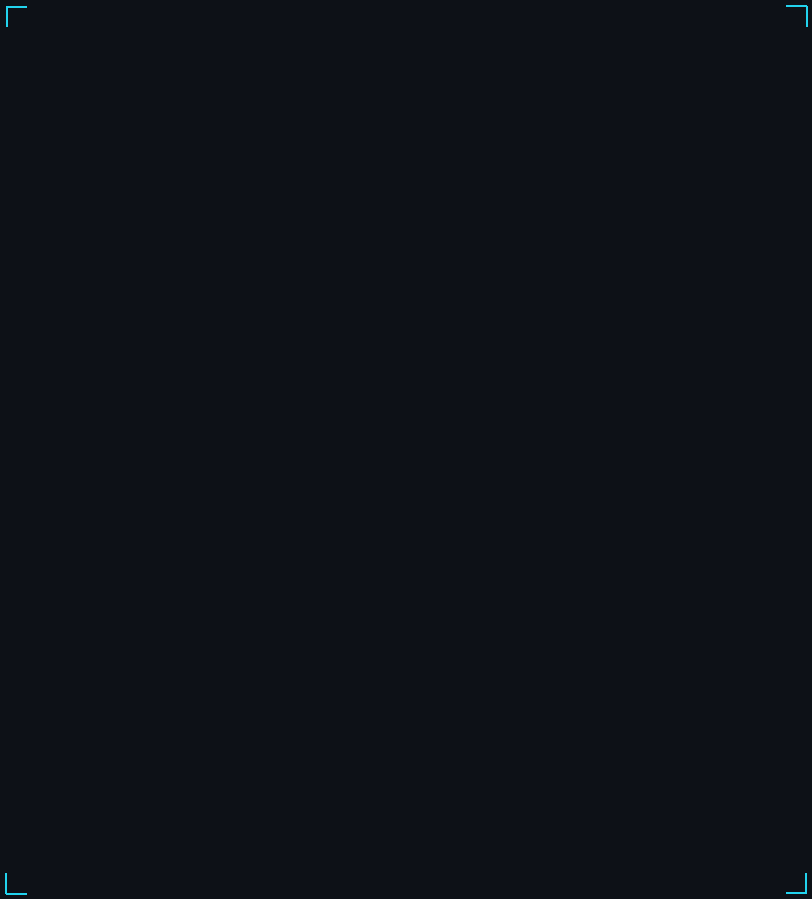


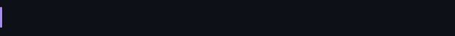

 

<!-- ───────────────────────────── 01 · ABOUT ───────────────────────────── -->


> I'm an **Integrated M.Tech student in Artificial Intelligence** who enjoys turning ideas into software that actually works. I'm drawn to AI, machine learning and software development, and I'm sharpening my problem-solving with **Data Structures & Algorithms in C++**.
>
> I like building practical applications that solve real-world problems, and I'm always excited to pick up new technologies. I learn best by building.

<table align="center">
  <tr>
    <td align="center"><b>Studying</b> Integrated M.Tech in Artificial Intelligence</td>
    <td align="center"><b>Practising</b> DSA in C++</td>
    <td align="center"><b>Building</b> Practical, real-world applications</td>
  </tr>
</table>

 

<!-- ───────────────────────── 02 · CURRENT FOCUS ───────────────────────── -->

  
   
  

 

<!-- ───────────────────────────── 03 · TECH STACK ───────────────────────────── -->

  
   
  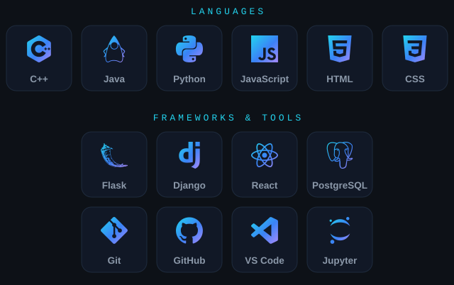

 

<!-- ────────────────────────── 04 · PROJECTS I'VE BUILT ────────────────────────── -->
<!--
  TO ADD A REPOSITORY LINK: replace the "link coming soon" line under a project with
  [View repository →](https://github.com/palakpandey28/YOUR-REPO-NAME)
  TO ADD A SCREENSHOT: add    under the banner.
-->


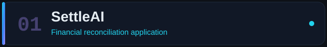

- A financial reconciliation application built around **CSV-based transaction reconciliation**.
- Makes comparing financial data simpler and less manual.

`CSV` &nbsp; `Reconciliation` &nbsp; `FinTech`

Repository · link coming soon <!-- PLACEHOLDER: SettleAI repository URL -->

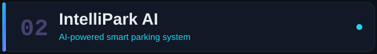

- An **AI-powered smart parking system** that detects which parking slots are free.
- **YOLO-based** slot detection with **OpenCV** image processing.
- Backend integration so parking slot status stays up to date.

`YOLO` &nbsp; `OpenCV` &nbsp; `Computer Vision` &nbsp; `Backend`

Repository · link coming soon <!-- PLACEHOLDER: IntelliPark AI repository URL -->

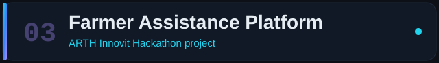

- Developed during the **ARTH Innovit Hackathon**.
- Gives farmers **mandi and location-based information**, with crop, quantity and price inputs.
- Built for accessibility with **local-language and voice-based** interaction.

`Hackathon` &nbsp; `Voice` &nbsp; `Local Language` &nbsp; `Accessibility`

Repository · link coming soon <!-- PLACEHOLDER: Farmer Assistance Platform repository URL -->

 

<!-- ────────────────────── 05 · CURRENTLY WORKING ON ────────────────────── -->
<!-- TO ADD A PROJECT: copy any row below, paste it at the top of the table and edit the two columns. -->


| Focus | What I'm doing |
| :-- | :-- |
| **AI-powered applications** | Putting AI to practical use |
| **ML experimentation** | Hands-on experiments with models |
| **Generative AI** | Exploring what it makes possible |
| **Backend & APIs** | Python/Flask services and integrations |
| **DSA & problem solving** | Steady practice in C++ |

 

<!-- ───────────────────────────── 06 · ANALYTICS ───────────────────────────── -->


<!-- Contribution snake: regenerated daily by .github/workflows/snake.yml and published to the `output` branch -->
<picture>
  <source media="(prefers-color-scheme: dark)" srcset="https://raw.githubusercontent.com/palakpandey28/palakpandey28/output/github-snake-dark.svg">
  <source media="(prefers-color-scheme: light)" srcset="https://raw.githubusercontent.com/palakpandey28/palakpandey28/output/github-snake.svg">
  
</picture>

 

<!-- ───────────────────────────── 07 · CONNECT ───────────────────────────── -->

  
   
  <a href="https://github.com/palakpandey28">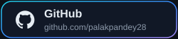</a>
  &nbsp;
  <!-- PLACEHOLDER: replace YOUR_LINKEDIN_USERNAME with your real LinkedIn handle -->
  
   
  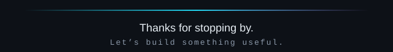

